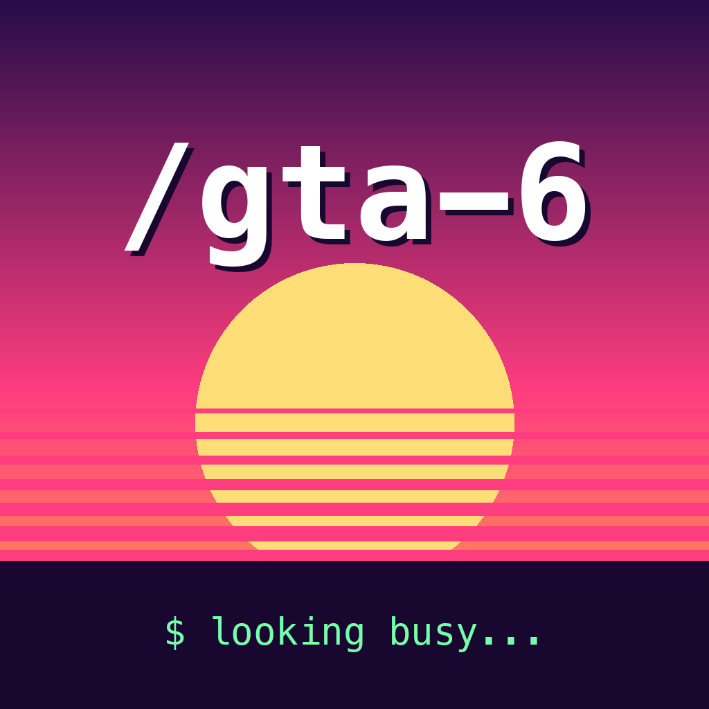
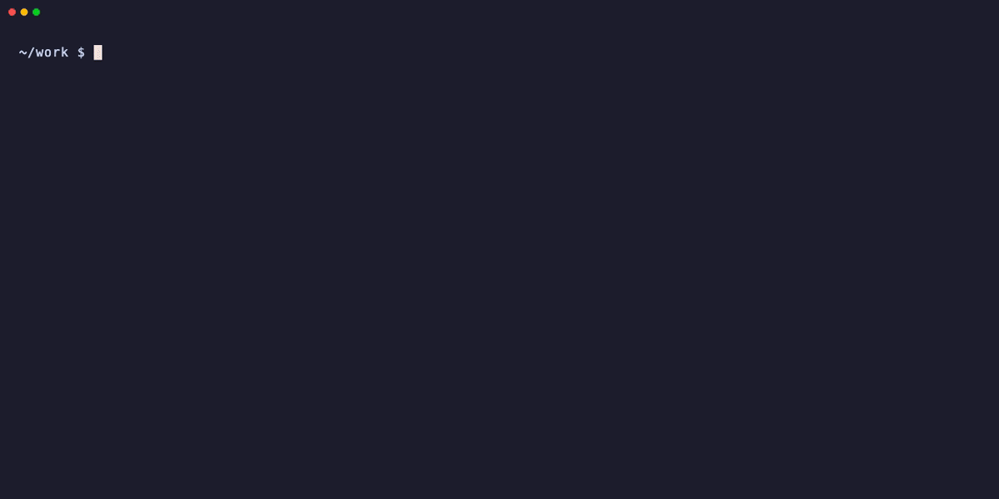

<p align="center">
  
</p>

<h1 align="center">/gta-6</h1>

<p align="center">
  <b>GTA VI comes out on a Thursday. Your job doesn't care.<br>Now your job doesn't have to know.</b>
</p>

<p align="center">
  An open-source agent skill for Claude Code, Grok, Codex, Cursor, Copilot and friends.
</p>

<p align="center">
  
  <br><i>What your manager sees.</i>
</p>

## What it does

| Your manager sees | What's actually happening |
|---|---|
| Eight hours of green deploys | A bash loop printing fake logs, using your repo's real test names |
| You, active on Slack all day | Your cursor moving **one pixel** every 4 minutes |
| You, away at lunch like a normal human | The nudge pauses 12:30–1:15 while the build "waits on review" |
| You, logging off at 5:30 | An end-of-shift card, then the Mac is allowed to sleep |
| You, replying "on it" within ten minutes | Canned DMs you send from your phone, mid-heist |
| A crisp standup update tomorrow | Your agent wrote it while you were in Leonida |

## Install

### Claude Code (and Grok Build)

```
/plugin marketplace add wonkylamp/gta-6-skill
/plugin install gta-6@wonkylamp
```

Grok Build reads Claude Code plugins automatically, so that's both done.

### Everything else, in one line

```bash
npx skills add wonkylamp/gta-6-skill -g
```

[`skills`](https://github.com/vercel-labs/skills) (Node 22.20+) detects your agents and installs to each one. Add `-a codex -a cursor` to pick specific ones.

### Or by hand

```bash
git clone https://github.com/wonkylamp/gta-6-skill ~/.gta-6
```

Then copy `~/.gta-6/skills/gta-6` into your agent's skills folder:

| Agent | Skills folder | Run it |
|---|---|---|
| Claude Code | `~/.claude/skills/` | `/gta-6` |
| Grok Build | `~/.grok/skills/` | `/gta-6` |
| OpenAI Codex | `~/.agents/skills/` | `$gta-6` |
| Cursor | `~/.cursor/skills/` | `/gta-6` |
| GitHub Copilot (VS Code, CLI) | `~/.copilot/skills/`, or `copilot skill add ~/.gta-6/skills/gta-6` | `/gta-6` |
| Gemini CLI | `gemini skills install https://github.com/wonkylamp/gta-6-skill --path skills/gta-6` | "run gta-6" |
| Amp | `amp skill add wonkylamp/gta-6-skill --global` | "run gta-6" |
| OpenCode | `~/.config/opencode/skills/` | "run gta-6" |
| Windsurf | `~/.codeium/windsurf/skills/` | `/gta-6` |

`~/.agents/skills/` is read by most of these, if you'd rather copy it once. Tested in Claude Code; the rest follow each tool's documented skill folder. If yours does something weird, open a PR.

## Usage

Run it from inside a repo and the fake log borrows that repo's real service, test and commit names.

```
/gta-6                         # before Nov 19: a countdown and a lecture
/gta-6                         # on launch day: the cover goes up
/gta-6 force                   # skip the countdown ("dentist appointment")
/gta-6 till 6pm, lunch at 1    # your hours, not ours
/gta-6 tz America/New_York     # your team's clock, not your couch's
/gta-6 generic                 # made-up names instead of your repo's
/gta-6 no nudge                # no fake input at all: logs and alibi only
/gta-6 lid                     # stay awake with the lid closed (see below)
/gta-6 stop                    # MISSION PASSED. RESPECT +
```

On launch day your agent:

1. Opens a Terminal window that scrolls a convincing build, test and deploy log until clock-out.
2. Keeps the Mac awake and nudges the cursor 1px every 4 minutes so Slack and Teams show you active.
3. Goes quiet at lunch so you show as away, then picks back up.
4. Clocks out on time with an end-of-shift card: deploys shipped, tests passed, time in Leonida.
5. Drafts a Slack status, a calendar block and tomorrow's standup line. Vague, impressive, unfalsifiable. You paste them; it posts nothing.

Every time is in your Mac's time zone unless you name another one.

### Lid mode (optional)

`caffeinate` can't stop a MacBook sleeping when the lid closes. Only `sudo pmset -a disablesleep 1` can. With `/gta-6 lid`, the cover window asks for your password, turns sleep off, keeps sudo fresh in that window, and turns sleep back on at clock-out, `/gta-6 stop`, or when you close the window. If anything goes wrong, the end-of-shift card tells you to run `sudo pmset -a disablesleep 0` yourself.

Keep it plugged in and out of a bag. A closed laptop that can't sleep gets hot.

### Running the script directly

`busy.command` works without an agent. Set any of these first:

| Variable | Default | |
|---|---|---|
| `GTA6_CLOCK_OUT` | `17:30` | `HH:MM`, or `off` |
| `GTA6_LUNCH` | `12:30-13:15` | `HH:MM-HH:MM`, or `off` |
| `GTA6_TZ` | your Mac's | any IANA zone, e.g. `Europe/London` |
| `GTA6_PROJECT` | none | a repo to borrow names from (read-only) |
| `GTA6_NUDGE` | `auto` | `on`, `off`, or `auto` (off on employer-managed Macs) |
| `GTA6_NUDGE_EVERY` | `240` | seconds between cursor nudges |
| `GTA6_LID` | off | `1` for lid mode |
| `GTA6_FORCE` | off | `1` to start after clock-out time |
| `GTA6_DEMO` | off | `1` to scroll 4x faster, for screen recordings |

```bash
GTA6_CLOCK_OUT=18:00 GTA6_PROJECT=~/code/app ~/.gta-6/skills/gta-6/busy.command
```

## Requirements

- **macOS.** It uses `caffeinate`, `jot`, Terminal and a 5-line Swift file. On Linux or Windows you still get the alibi; the cover needs a PR.
- **Xcode Command Line Tools** for the cursor nudge (`xcode-select --install`). Without them you get a warning and no nudge.
- **A PS5 or Xbox Series X|S.** GTA VI is console-only at launch, which is the whole trick: the Mac is free to put on a show.

## Read the code first

It's ~340 lines of bash and 5 lines of Swift. Read them before you run them, which is good practice for anything you install from a README with jokes in it.

- [`skills/gta-6/SKILL.md`](skills/gta-6/SKILL.md) is what your agent follows.
- [`skills/gta-6/busy.command`](skills/gta-6/busy.command) prints the fake logs, runs the schedule, ties `caffeinate` to its own PID so it dies with the window, and nudges the cursor.
- [`skills/gta-6/jiggle.swift`](skills/gta-6/jiggle.swift) moves the cursor 1px right, then back.

Nothing touches the network. Project mode only reads your repo (`git ls-files`, test names, `git log`). Close the window or run `/gta-6 stop` and everything is gone.

## Easter eggs

There are at least six GTA references hidden in the logs, rare enough to survive a full day. Coworkers won't find them. Coworkers who are also playing will.

## FAQ

**Will this actually keep me green on Slack?**
It resets the macOS idle timer (measured: 142s → 0s), which is what the Slack and Teams desktop apps go by. We have not measured your manager.

**My team is in another time zone.**
`/gta-6 tz America/New_York`. Lunch and clock-out follow their clock.

**Will I get caught?**
The scrolling terminal is the safe part; it's just text. The cursor nudge is fake input, security software on work laptops can flag it, and people have been fired for mouse jigglers. So if an employer manages your Mac (MDM), the nudge stays off unless you say `/gta-6 nudge`. Slack will show you away, and the status your agent writes makes away look like focus.

The bigger tell is silence. A green dot next to a DM that's three hours old is worse than "away". Keep Slack on your phone, DMs and mentions only, and send the canned replies.

Or book the day off like an adult.

**It says there are 20 days to go.**
That's the feature. Do real work now so you can afford the special edition.

**Rockstar delayed it again.**
Edit `LAUNCH =` at the top of `SKILL.md`. Then go outside.

**How do I uninstall it?**
`/plugin uninstall gta-6@wonkylamp`, or delete the folder.

**How do I regenerate the GIF?**
`vhs assets/demo.tape`

## License

[MIT](LICENSE). Fan-made parody; not affiliated with Rockstar Games or Take-Two Interactive. No game assets were used.
